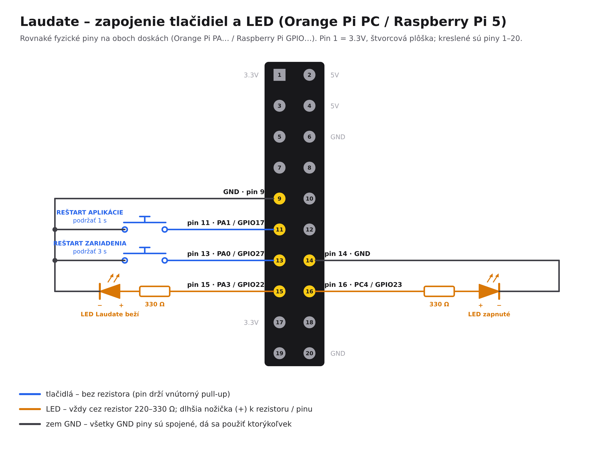

# Laudate (tvdisplay)

Zobrazovanie textov piesní, žalmov, obrázkov a PDF prezentácií na TV v kostole.
Ovládanie beží v prehliadači na mobile/PC, displej na zariadení pri TV (napr. Raspberry Pi v kiosk režime).

## Spustenie

```bash
npm install
cp .env.example .env   # doplň GITHUB_TOKEN a prípadne CONTROL_PIN
npm run prod           # zostaví aplikáciu a spustí server
```

- Ovládanie: `http://<IP>:5173/#control`
- Displej: `http://<IP>:5173/#display` (kláves **F** = celá obrazovka)

Vývoj s automatickým obnovovaním: `npm run dev` (server + Vite).

## Orange Pi PC

Inštalátor je jeden súbor s hotovou aplikáciou (na zariadení sa nič nekompiluje):

```bash
./scripts/build_orangepi_installer.sh                 # na počítači, vytvorí dist-orangepi/
sudo bash tvdisplay-orangepi-install.sh               # na Orange Pi (Armbian, Debian, Ubuntu)
```

Aplikácia sa nainštaluje do `/opt/tvdisplay` a spúšťa sa sama po zapnutí. Nastavenia sú v `/opt/tvdisplay/.env`.
Opätovné spustenie inštalátora aplikáciu aktualizuje a nezmení nastavenia, piesne ani prezentácie.
Voľby: `--yes`, `--no-kiosk` (bez obrazovky na TV), `--no-powerpoint` (bez LibreOffice), `--tailscale`,
`--nas-url=…` (piesne na NAS, pozri nižšie), `--church-url=ADRESA` (administrácia kostolov).

## Piesne, fotky a prezentácie na NAS (Synology)

Aplikácia beží na Orange Pi, na NAS je iba priečinok s dátami. Každý kostol má na NAS svoj priečinok
a jeho Orange Pi dostane odkaz naň (adresu priečinka).

Texty, fotky a prezentácie stačí vložiť do priečinka kostola, napr. cez **File Station** alebo **Synology Drive**:

```
tvdisplay/
  kostol-sv-martina/                      ← odkaz pre Orange Pi v tomto kostole
    texty/
      Ohlášky.txt                         → kategória „Vlastné“
      150 Ó, Ježišu môj zranený.txt       → pieseň č. 150 (číslo JKS určí kategóriu, tu Pôstne)
      Pohreb/Odpočinutie večné.txt        → podpriečinok = kategória „Pohreb“
    obrazky/
      Vianoce.jpg                         → JPG, PNG, WEBP, GIF
    prezentacie/
      Ohlášky 1. nedeľa.pdf               → PDF (PowerPoint iba ak je na Orange Pi LibreOffice)
    songs.json, images.json, media/       ← spravuje aplikácia, nemeň ručne
```

- **Texty** sú obyčajné `.txt` súbory (UTF-8, ako ich uloží Poznámkový blok). Strofy oddeľ prázdnym riadkom,
  každá strofa je jedna strana na TV. Názov súboru je názov piesne. Číslo na začiatku („150 …“, „150. …“)
  je číslo piesne.
- Nový, zmenený alebo zmazaný súbor sa v ovládaní aj na TV prejaví do minúty, bez reštartu.
- Položky zo súborov majú v ovládaní značku **NAS** a menia sa iba na NAS. Spevník JKS a texty, fotky
  a prezentácie pridané v ovládaní (záložka **Obsah**, chránená PIN-om) sa ukladajú do `songs.json`,
  `images.json` a `media/` v tom istom priečinku.

- Orange Pi má kópiu dát u seba, takže TV aj ovládanie fungujú, aj keď NAS alebo internet nie je dostupný.
  Zmeny urobené bez spojenia sa na NAS nahrajú, keď sa spojenie obnoví.
- Každú minútu kontroluje zmeny na NAS – viac Orange Pi s tým istým priečinkom (napr. v jednom kostole) vidí
  tie isté piesne. Každý kostol môže mať na NAS svoj podpriečinok.
- Pri prvom spustení s prázdnym priečinkom sa naň nahrajú piesne, fotky a prezentácie, ktoré Orange Pi už má
  (celý spevník JKS aj vlastné úpravy).

### Nastavenie NAS (raz)

1. **Centrum balíkov** → nainštaluj **WebDAV Server** a v jeho nastaveniach zapni HTTP (port 5005).
2. **Ovládací panel → Zdieľaný priečinok** → vytvor priečinok `tvdisplay`.
3. **Synology Drive Admin Console → Tímový priečinok** → zapni priečinok `tvdisplay`.
   Uvidíš ho v Synology Drive (aplikácia v počítači či mobile aj web), nahrávaš doň texty, fotky a prezentácie
   a ľuďom môžeš posielať zdieľacie odkazy ako doteraz.
4. **Ovládací panel → Používateľ** → vytvor používateľa napr. `tvdisplay` pre Orange Pi:
   - právo **Čítať/Zapisovať** iba na priečinok `tvdisplay`,
   - v časti **Aplikácie** povoľ **WebDAV**.
5. **Centrum balíkov** → nainštaluj **Tailscale** a prihlás sa ním do svojho Tailscale účtu (bezplatný, napr. cez Google účet).
   V admin konzole Tailscale (login.tailscale.com) uvidíš názov NAS, napr. `karajos-nas`.
   Ak chceš inštalovať Orange Pi bez prihlasovania odkazom, vytvor tam kľúč: **Settings → Keys → Generate auth key**
   (zaškrtni *Reusable*, aby platil pre viac Orange Pi).

Podpriečinok kostola netreba vytvárať, Orange Pi si ho vytvorí sám. Zdieľací odkaz zo Synology Drive
(`…quickconnect.to/d/s/…`) je iba pre ľudí: ide cez QuickConnect, je len na čítanie a Orange Pi ho nevie použiť.
Orange Pi dostane adresu priečinka cez WebDAV.

**Prečo Tailscale:** NAS a Orange Pi v kostoloch nie sú v jednej sieti. Tailscale ich spojí šifrovane cez internet
bez presmerovania portov na routeri, takže WebDAV (port 5005) nie je viditeľný z internetu.
Adresa priečinka pre Orange Pi potom je `http://<názov-NAS-v-Tailscale>:5005/tvdisplay/<kostol>`,
napr. `http://karajos-nas:5005/tvdisplay/kostol-sv-martina`. Orange Pi v tej istej sieti ako NAS môže použiť
priamo `http://192.168.x.x:5005/tvdisplay/<kostol>` a Tailscale nepotrebuje.

### Nastavenie Orange Pi

- **Nová inštalácia:** inštalátor sa opýta na adresu priečinka, meno a heslo a na to, či je NAS v inej sieti.
  Ak áno, nainštaluje Tailscale a pripojí sa kľúčom, alebo zobrazí odkaz, ktorý otvoríš v mobile a prihlásiš sa.
- **Už nainštalované Orange Pi:**

```bash
sudo bash tvdisplay-orangepi-install.sh --tailscale \
  --nas-url=http://karajos-nas:5005/tvdisplay/kostol-sv-martina --nas-user=tvdisplay --nas-password=HESLO
```

S kľúčom namiesto odkazu: pridaj `--tailscale-authkey=tskey-auth-…`.

Pri HTTPS s certifikátom, ktorý vystavil samotný NAS (nie Let's Encrypt), pridaj `--nas-ignore-cert`.
Stav spojenia s NAS je v ovládaní v záložke **Obsah → Synchronizácia**.
Napojenie zrušíš voľbou `--nas-url=` (prázdna adresa); piesne sa potom znova berú z GitHubu.

## Administrácia kostolov s prihlasovaním (Docker na NAS)

Centrálna stránka s prihlásením, kde sa spravujú piesne, kategórie, obrázky a prezentácie viacerých kostolov.
Beží na NAS a zapisuje **priamo do zdieľaného priečinka `tvdisplay`** – do toho istého `tvdisplay/<kostol>/`,
ktorý čítajú Orange Pi cez WebDAV (časť vyššie). Zmena v administrácii sa na TV prejaví do minúty.
Kostol, ktorého priečinok už existuje (vytvorilo ho Orange Pi alebo človek), sa v administrácii objaví sám.

- **Administrátor** vytvára kostoly a používateľov a môže upravovať obsah všetkých kostolov.
- **Editor** má priradený jeden kostol a vidí iba ten.
- Každý kostol má **vlastné piesne**. Nový kostol dostane kópiu celého spevníka JKS, ktorú potom môže ľubovoľne meniť.
  Tlačidlo **Doplniť piesne JKS** (záložka Kostoly) pridá do všetkých kostolov piesne JKS, ktoré im chýbajú;
  piesne, ktoré kostol už má (aj upravené), sa neprepíšu.
- Orange Pi v kostole si dáta svojho kostola sťahuje z administrácie každú minútu.
  Má ich uložené aj u seba, takže funguje aj bez internetu.
  Zmena v administrácii sa na TV aj v ovládaní prejaví sama, bez obnovenia stránky.

### Inštalácia na NAS

1. V Centre balíkov nainštaluj **Container Manager**.
2. Stiahni tento repozitár (GitHub → *Code* → *Download ZIP*) a cez File Station ho rozbaľ, napr. do `/docker/tvdisplay`.
3. V `docker-compose.yml`:
   - zmeň `ADMIN_PASSWORD` (heslo prvého administrátora, použije sa iba pri prvom spustení),
   - skontroluj cestu k zdieľanému priečinku `/volume1/tvdisplay` (File Station → `tvdisplay` → Vlastnosti → Umiestnenie;
     na NAS s viacerými zväzkami môže byť napr. `/volume2/tvdisplay`).
4. Container Manager → **Projekt** → **Vytvoriť** → cesta `/docker/tvdisplay` → použiť existujúci `docker-compose.yml`.
   Prvé zostavenie trvá niekoľko minút.
5. Otvor `http://<IP-NAS>:8080` (alebo cez Tailscale `http://<názov-NAS>:8080`) a prihlás sa ako `admin`. Potom:
   - zmeň si heslo (ikona 🔑),
   - v záložke **Kostoly** pridaj kostoly (každý dostane priečinok `tvdisplay/<kostol>` so spevníkom JKS) –
     pri kostole je adresa priečinka pre Orange Pi (`--nas-url`),
   - v záložke **Používatelia** vytvor editorov a priraď im kostol.

Upravuj obsah radšej na jednom mieste naraz: ak sa tá istá pieseň zmení v administrácii aj v ovládaní
na Orange Pi v tej istej minúte, platí neskoršia zmena. Súbory vložené cez Synology Drive do `texty/`,
`obrazky/` a `prezentacie/` administrácia nemení, Orange Pi ich zobrazí ako doteraz.

Ak by Orange Pi po úprave v administrácii hlásilo pri ukladaní chybu prístupu (403), nastav v File Station
pre priečinok `tvdisplay` → Vlastnosti → Povolenie používateľovi `tvdisplay` Čítať/Zapisovať a zaškrtni
*Použiť na tento priečinok, podpriečinky a súbory*.

**Prístup z internetu** (pre editorov a pre Orange Pi v kostoloch):
1. Ovládací panel → Prihlasovací portál → Rozšírené → **Reverzný proxy server**.
2. Pridaj pravidlo z `https://<tvoja-adresa>:443` na `http://localhost:8080`.
3. Certifikát Let's Encrypt získaš v Ovládací panel → Zabezpečenie → Certifikát.

Používaj **HTTPS**, inak by heslá išli cez internet nezašifrované.
Na serveri administrácie je ovládanie TV vypnuté, nedá sa cez neho nič zobraziť ani zmeniť.

**Dáta** sú v priečinku `admin-data` vedľa `docker-compose.yml`. Zálohuj ho, napr. cez Hyper Backup.
Zmazané kostoly sa presúvajú do `admin-data/deleted/`.

**Zabudnuté heslo:**

```bash
docker exec -it tvdisplay-admin node server/set-password.js admin NoveHeslo123 --admin
```

**Aktualizácia:**
1. Nahraj nové súbory (priečinok `admin-data` nechaj tak).
2. V Container Manageri: Projekt → Akcia → **Zostaviť**.

PowerPoint sa na NAS na PDF neprevádza (v kontajneri nie je LibreOffice), nahrávaj prezentácie ako PDF.

### Napojenie Orange Pi na administráciu

V administrácii v záložke **Kostoly** skopíruj adresu kostola (napr. `https://mojnas.synology.me/api/public/churches/kostol-sv-martina`).

- **Nová inštalácia:** inštalátor sa na adresu opýta.
- **Už nainštalované Orange Pi:** spusti inštalátor s voľbou:

```bash
sudo bash tvdisplay-orangepi-install.sh --church-url=https://mojnas.synology.me/api/public/churches/kostol-sv-martina
```

V ovládaní sa potom piesne, obrázky a prezentácie neupravujú, záložka **Obsah** odkáže na administráciu.
Obrázky a prezentácie ostávajú v záložke Obsah, odkiaľ sa dajú pridať do poradia a nastaviť ako pozadie.
Napojenie zrušíš voľbou `--church-url=` (prázdna adresa); piesne sa potom znova berú z GitHubu.

Vývoj administrácie na počítači: `ADMIN_DATA_DIR=admin-data ADMIN_PASSWORD=heslo1234 npm run dev`, potom `http://localhost:5173/#admin`.

## Aplikácia do telefónu a tabletu

V ovládaní ťuknite na **📲** (hore vpravo):

- **Android** – tlačidlo stiahne `Laudate.apk` priamo zo zariadenia v kostole (alebo Chrome ⋮ → *Pridať na plochu*).
- **iPhone / iPad** – Safari → *Zdieľať* → *Pridať na plochu*; ikona Laudate otvorí ovládanie na celú
  obrazovku bez panelu Safari (manifest a ikony v `public/`).
- **Z počítača** – QR kód s adresou ovládania na naskenovanie telefónom.

## Aplikácia pre Android

Ovládanie z mobilu sa dá používať aj ako aplikácia **Laudate** (`dist-android/Laudate.apk`).
Je to okno s webovým ovládaním `http://<IP adresa Orange Pi>:5173/#control`, navyše:

- pripojí sa priamo na 192.168.1.15 (iná adresa sa dá zadať cez tlačidlo Späť → Zmeniť adresu; port 5173 sa doplní sám),
- obrazovka mobilu počas omše nezhasne,
- keď sa zariadenie nedá nájsť, ukáže sa „Skúsiť znova“ / „Zmeniť adresu“,
- tlačidlo Späť ponúkne obnovenie stránky, zmenu adresy alebo ukončenie.

**Inštalácia:** stiahnite `Laudate.apk` do mobilu (napr. z GitHubu alebo cez e-mail), otvorte ho a povoľte
inštaláciu z neznámych zdrojov. Aplikácia nie je v Google Play.

**Zostavenie:** `scripts/build_android.sh` (Java 17+ a Android SDK). Kľúč na podpis nie je v repozitári:
súbor `laudate.keystore` a `keystore.properties` (storeFile, storePassword, keyAlias, keyPassword) dajte do
priečinka `android/` a nikam ich nezverejňujte. Novú verziu treba podpísať tým istým kľúčom, inak sa nedá
nainštalovať cez starú; pred novou verziou zvýšte `versionCode` v `android/app/build.gradle`.

## Ako to funguje

```
Mobil / PC (ovládanie) ──PATCH /api/state──►  server (port 3002)  ──WebSocket──►  všetky zariadenia
                                              │  state.json, uploads/, Texty/
                                              └─ GitHub (songs.json, images.json) – token je iba na serveri
```

- **Synchronizácia** cez WebSocket, zmeny sa prejavia okamžite. Pri výpadku sa klient sám pripojí znova.
  Bez servera funguje len v rámci jedného prehliadača (localStorage).
- **Piesne a obrázky** sa načítavajú z GitHubu. Keď nie je dostupný, použije sa lokálna kópia na serveri
  a potom posledná verzia uložená v prehliadači.
- **Ukladanie** (nový text, obrázok, PDF) ide cez server, ktorý súbor uloží lokálne aj na GitHub.
- **Prezentácie** (PDF, PPT, PPTX, ODP) sa nahrávajú na server do `uploads/`, v `songs.json` je iba odkaz.
  Počet strán sa zistí automaticky. PowerPoint server prevedie na PDF cez LibreOffice:
  na Raspberry Pi `sudo apt install libreoffice-impress` (bez neho funguje iba PDF).
- **Kategórie** piesní zodpovedajú oddielom spevníka JKS podľa čísla piesne (adventné 1–33, vianočné 34–113, …,
  latinské 532–543), rozsahy sú v `server/jksCategories.js`. Po pridaní piesní s číslom JKS do `songs.json`
  ich zaradí `node scripts/categorize_jks.js`.
- **Žalmy** sú v `Texty/Žalmy RRRR.json`. Nový rok stiahneš cez `node scripts/fetch_psalms_2027.js`.
- **PIN**: ak je v `.env` nastavený `CONTROL_PIN`, ovládanie si ho vypýta. Displej PIN nepotrebuje.
- **Administrácia kostolov** (`ADMIN_DATA_DIR`) a **napojenie na ňu** (`CHURCH_DATA_URL`): pozri vyššie.

## Raspberry Pi 5 namiesto Orange Pi

Ten istý inštalátor (`dist-orangepi/tvdisplay-orangepi-install.sh`) funguje aj na **Raspberry Pi 5** (aj Pi 4) –
dosku rozpozná sám. Raspberry Pi má v sebe **Wi-Fi**, takže nemusí mať kábel do siete.

1. Kartu priprav cez **Raspberry Pi Imager**: *Raspberry Pi OS Lite (64-bit)*, v nastaveniach (ozubené koliesko)
   zapni SSH, zadaj používateľa a **Wi-Fi kostola**.
2. Prihlás sa cez SSH a spusti inštalátor ako pri Orange Pi. Wi-Fi sa dá zadať aj inštalátorom – sieť nemusí byť
   práve v dosahu (napr. inštalácia doma, zapojenie v kostole):
   ```bash
   sudo bash tvdisplay-orangepi-install.sh --wifi-ssid="Farnosť" --wifi-password="heslo"
   ```
3. Tlačidlá a LED sa zapájajú na **tie isté fyzické piny** ako pri Orange Pi (pin 9, 11, 13, 14, 15, 16).

Čo treba navyše: kábel **micro-HDMI → HDMI** (Pi 5 nemá veľké HDMI), oficiálny zdroj **USB-C 27 W (5 V / 5 A)**
a chladič (Active Cooler). Orange Pi PC Wi-Fi nemá – pripojí sa káblom alebo cez USB Wi-Fi adaptér
(potom funguje aj `--wifi-ssid`).

## Ochrana SD karty pri výpadku prúdu

V kostole sa prúd často vypína vypínačom. Inštalátor preto vždy:

- ukladá dáta aplikácie bezpečne (dočasný súbor, zápis na kartu, premenovanie) – pri výpadku ostane starý
  alebo nový celý súbor; stav TV sa ukladá najviac raz za 5 s a pri vypnutí služby,
- odkladá do komprimovanej pamäte (zram) namiesto odkladacieho súboru na karte,
- drží záznamy systému (`journalctl`) a profil prehliadača na TV len v pamäti, `/tmp` v pamäti.

**Režim len na čítanie** (voliteľný, najbezpečnejší): karta sa vôbec nezapisuje, všetky zmeny sú v pamäti
a po reštarte sa zahodia (piesne z NAS sa po štarte stiahnu znova).

```bash
sudo laudate-ochrana zapnut   # potom sudo reboot
sudo laudate-ochrana stav
sudo laudate-ochrana vypnut   # pred aktualizáciou alebo zmenou nastavení, potom sudo reboot
```

Funguje na Raspberry Pi OS (cez `raspi-config`) a na systémoch s balíkom `overlayroot` (Armbian/Ubuntu).
Dá sa zapnúť aj rovno inštalátorom: `--ochrana-sd`. Pri zapnutej ochrane inštalátor odmietne aktualizáciu
(po reštarte by sa stratila). Stav ochrany je vidno v ovládaní: ⚙ → Obrazovka → Zariadenie v kostole.

## Reštart aplikácie a zariadenia (tlačidlá)

**V ovládaní:** ⚙ → Obrazovka → *Zariadenie v kostole* → „Reštartovať aplikáciu“ alebo „Reštartovať Orange Pi / Raspberry Pi“
(ak je nastavený PIN, chráni aj tieto tlačidlá).

**Fyzické tlačidlá a LED** (inštalátor ich zapne sám, vypnúť: `--no-buttons`). Dve obyčajné tlačidlá (spínacie, bez aretácie)
a dve LED na 40-pinovom konektore Orange Pi PC. Tlačidlá bez rezistorov (pin drží vnútorný pull-up),
každá LED cez rezistor 220–330 Ω (dlhšia nožička LED = + smerom k pinu).

| | Pin | Druhý kontakt | Podržať |
|---|---|---|---|
| Tlačidlo reštart aplikácie (spustí ju aj keď nebeží) | 11 (Orange Pi PA1 / Raspberry Pi GPIO17) | GND pin 9 | 1 s |
| Tlačidlo reštart zariadenia | 13 (PA0 / GPIO27) | GND pin 9 | 3 s |
| LED „Laudate beží“ | 15 (PA3 / GPIO22) | rezistor 220–330 Ω → GND | – |
| LED „zapnuté“ | 16 (PC4 / GPIO23) | rezistor 220–330 Ω → GND pin 14 | – |



**Kontrolky:** LED „zapnuté“ svieti, kým je zariadenie zapnuté; LED „Laudate beží“ svieti, kým aplikácia
odpovedá (zhasne pri reštarte aplikácie alebo keď aplikácia nebeží). Pri držaní tlačidla jeho LED bliká –
vidno, že stlačenie zariadenie zaznamenalo; pri reštarte zariadenia LED „zapnuté“ bliká, kým sa nevypne.

```
pin  9 GND ──┬──────────┐            pin 14 GND ──┬──────────────┐
          [APP]     [REBOOT]                      │              │
pin 11 ──────┘          │                   [LED APP]≺       [LED REBOOT]≺
pin 13 ─────────────────┘            pin 15 ──[330 Ω]┘   pin 16 ──[330 Ω]┘
```

Iné piny, LED alebo čas držania: `/etc/default/laudate-buttons` (LED vypnete prázdnym `LED_APP_LINE=` / `LED_REBOOT_LINE=`), potom `sudo systemctl restart tvdisplay-buttons`.
Záznamy: `journalctl -u tvdisplay-buttons -f`.

## Televízor na výšku

V ovládaní v záložke **Obrazovka → Otočenie obrazovky** sa dá obraz na TV otočiť: na šírku, na výšku (doprava
alebo doľava) alebo hore nohami. Nastavenie sa uloží na zariadení v kostole, takže platí pre všetky televízory
a ostane aj po reštarte. Náhľady v ovládaní sa pri TV na výšku zobrazujú na výšku.

## Priebeh omše

1. V záložke **Omša** klikaj na piesne v zozname, každá sa pridá na koniec **poradia**.
   Žalm pridáš tlačidlom **+ Žalm** (predvolene najbližšia nedeľa). Poradie meníš ťahaním za úchyt ⠿.
2. Počas omše stačí stláčať **Ďalej** v spodnej lište (alebo → / PageDown / kliker):
   prechádzajú sa strofy a na poslednej strofe sa automaticky zobrazí ďalšia položka poradia.
3. **▶** zobrazí pieseň hneď, aj mimo poradia. Potom „Ďalej“ pokračuje v poradí tam, kde sa skončilo.
4. **Skryť** (kláves H) skryje text a ukáže pozadie.

Záložka **Obrazovka**: farebná téma TV (automaticky podľa liturgického obdobia), pozadie a voľba
„Text cez obrázok pozadia“. Záložka **Obsah**: nové texty, obrázky, PDF a stav synchronizácie.
Ikona ◐ v hlavičke prepína svetlý/tmavý režim ovládania.

## Ovládanie klávesnicou

| Kláves | Akcia |
| --- | --- |
| → / PageDown | ďalšia strofa, na poslednej strofe ďalšia položka poradia |
| ← / PageUp | predchádzajúca strofa, na prvej strofe predchádzajúca položka |
| H | skryť / zobraziť text na TV |

Fungujú aj bežné klikery na prezentácie (posielajú PageUp/PageDown).

## Ladenie

Ladiace výpisy v konzole zapneš príkazom `localStorage.setItem('tvdisplay-debug', '1')` alebo pridaním `?debug` do URL.

## Štruktúra

- `server/index.js` – API, WebSocket, GitHub, nahrávanie PDF, servírovanie `dist/`
- `server/admin.js` – administrácia kostolov (prihlásenie, kostoly, používatelia, obsah)
- `server/churchSync.js` – Orange Pi: sťahovanie dát kostola z administrácie a ich kópia na disku
- `server/nasStorage.js` – Orange Pi: piesne, fotky a prezentácie v priečinku na NAS (WebDAV) a ich kópia na disku
- `src/admin/*` – stránka administrácie (`#admin`)
- `src/api/stateClient.js` – zdieľaný stav a pripojenie
- `src/api/api.js` – knižnica piesní, obrázkov, PDF a žalmov
- `src/pages/ControlPage.jsx`, `src/components/control/*` – ovládanie
- `src/pages/DisplayPage.jsx`, `src/components/Stage.jsx` – displej (rovnaký `Stage` sa používa aj v náhľade)
- `archiv/` – staré jednorazové skripty a dokumentácia

Automatické spúšťanie po zapnutí: pozri [AUTOSTART.md](AUTOSTART.md).
